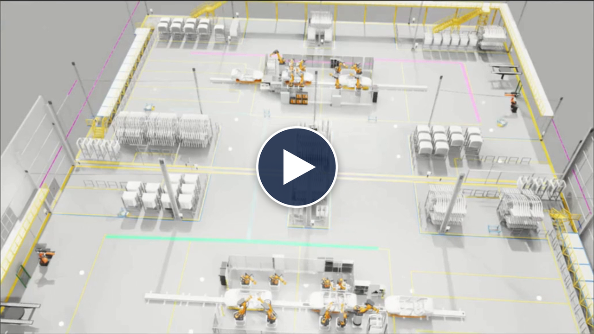
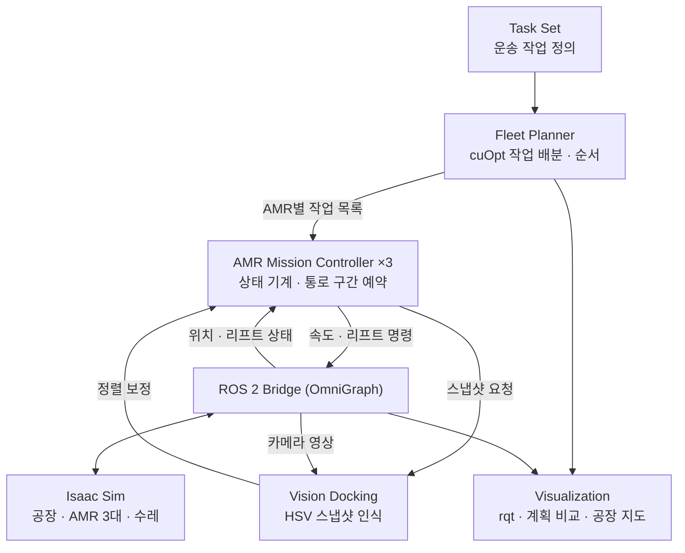
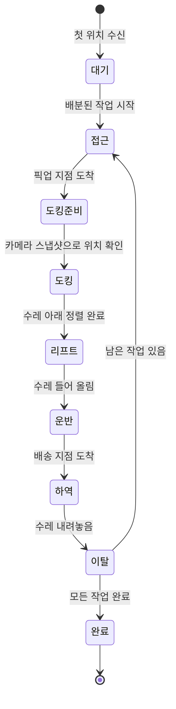
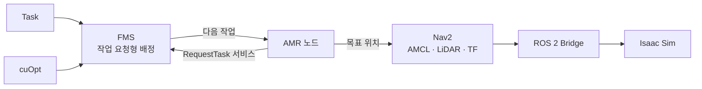

# Isaac Sim 기반 Multi-AMR 공장 자동화 Digital Twin

> 여러 대의 AMR이 가상 공장에서 부품 수레(Dolly)를 나눠 운송하는 과정을 NVIDIA Isaac Sim 디지털 트윈으로 재현하고,
> 작업 배분(NVIDIA cuOpt) · AMR 미션 제어 · 카메라 도킹을 ROS 2로 하나의 흐름으로 연결한 프로젝트입니다.

Doosan Robotics ROKEY BOOT CAMP 9기 협동 프로젝트(4인 팀, 2026.08.14 ~ 2026.08.31)

## 목차

1. [프로젝트 개요](#1-프로젝트-개요)
2. [시연 영상](#2-시연-영상)
3. [전체 시스템 아키텍처](#3-전체-시스템-아키텍처)
4. [프로젝트 전체 기능](#4-프로젝트-전체-기능)
5. [팀원별 역할](#5-팀원별-역할)
6. [주요 기술](#6-주요-기술)
7. [문제 해결 과정](#7-문제-해결-과정)
8. [최종 결과와 검증 범위](#8-최종-결과와-검증-범위)
9. [프로젝트 구조](#9-프로젝트-구조)
10. [관련 문서](#10-관련-문서)

---

## 1. 프로젝트 개요

| 항목 | 내용 |
|---|---|
| 주제 | 혼류생산 공장의 부품 운송 자동화 — Multi-AMR Digital Twin |
| 환경 | NVIDIA Isaac Sim 5.1 · ROS 2 Jazzy · Ubuntu 24.04 |
| 로봇 | 공장 씬 안의 AMR 3대(iw.hub)와 부품 수레(Dolly) |
| 핵심 흐름 | 운송 작업 정의 → cuOpt로 AMR별 작업 배분 → AMR별 미션 컨트롤러가 이동 · 도킹 · 리프트 · 운반 · 하역 실행 → 도킹 직전 카메라로 수레 위치 확인 |

**풀려던 문제.** 여러 AMR이 한 공장에서 수레를 옮기면 한 대만 시험할 때는 드러나지 않는 문제가 생깁니다.
- 어떤 로봇이 어떤 작업을 어떤 순서로 맡을지 정해야 합니다.
- 같은 통로를 여러 대가 함께 지나가야 합니다.
- 수레 앞에서는 정확히 정렬해 도킹해야 합니다.

이런 문제를 실제 장비 없이 시험하기 위해 공장 레이아웃과 AMR을 Isaac Sim에 올리고, 계획 · 제어 · 인식을 ROS 2로 연결했습니다.

**목표와 결과.** 작업 배분부터 AMR 이동 · 도킹 · 운반 · 위치 피드백까지 한 흐름으로 이어지는 시뮬레이션을 만드는 것이 목표였습니다.
최종 시연에서는 AMR 3대가 배분받은 운송 작업에 따라 수레에 도킹해 옮기는 과정을 한 PC에서 실행했습니다.

**저장소 구성.** 이 프로젝트는 단계별로 저장소를 나눠 관리했습니다. 이 저장소가 최종 버전(v2)입니다.

| 저장소 | 용도 |
|---|---|
| [cobot3_project](https://github.com/rokeydg1-sudo/cobot3_project) (v1) | 통합 단계(08-21 ~ 08-24): 작업 요청형 FMS · cuOpt · Nav2 통합 |
| **cobot3_project2 (v2, 이 저장소)** | 최종 구성(08-25 ~ 08-30): cuOpt 배분 · 미션 컨트롤러 · 스냅샷 비전 도킹. v1 통합 단계 커밋(`c831af5`)에서 이어 시작해 커밋 이력에 v1 시기 커밋이 함께 있습니다 |
| [cobot3_ws](https://github.com/rokeydg1-sudo/cobot3_ws) | 수업 기록용(08-14 ~ 08-20): Isaac Sim 기초 실습 · M0609 IK · Nova Carter 순찰 |

## 2. 시연 영상

[](https://drive.google.com/file/d/1WnyAafOIoRUPnHW795PIFgpIlmNVxHKE/view?usp=sharing)

- 위 이미지를 누르면 Google Drive에서 팀 시연 영상 전체가 재생됩니다.
- 같은 영상의 Isaac Sim 화면 구간(약 56초, 무음)은 저장소에도 보존했습니다: [docs/readme_assets/demo_clip.mp4](docs/readme_assets/demo_clip.mp4) (GitHub 파일 화면에서는 재생되지 않고 내려받기만 됩니다).
- 순서: 경로 계획 화면 → AMR 경로 주행 → 카메라로 수레 인식 → 도킹 · 운반 → 배분 계획 비교 → 3대 동시 운행

## 3. 전체 시스템 아키텍처

### 3-1. 최종 시연 구성



| 연결 | ROS 2 토픽 |
|---|---|
| 미션 컨트롤러 → 브리지 | `/cmd_vel`(주행), `/lift_cmd` · `/dolly_cmd`(리프트 · 수레) |
| 브리지 → 미션 컨트롤러 | `/odom` · `/tf`(위치), `/lift_joint_state` |
| 미션 컨트롤러 ↔ 미션 컨트롤러 | `/traffic/claims`(통로 구간 예약 공유) |
| 미션 컨트롤러 ↔ 비전 도킹 | `/dock/snapshot_request` → `/dock/snapshot_result` · `/dock/cmd_vel` |

| 모듈 | 역할 | 주요 파일 |
|---|---|---|
| Task / Inventory | 운송 작업(픽업 · 배송 위치)과 수레 위치 정의 | [standalone_factory_bridge.py](simulation/isaac_sim/standalone_factory_bridge.py) |
| Fleet Planner | 공장 지도 그래프의 최단경로 비용으로 AMR별 작업 배분 · 순서 계산. cuOpt 풀이와 비교용 풀이(exact · greedy · manual) | [plan_cuopt.py](scripts/plan_cuopt.py), [mission_planner.py](simulation/isaac_sim/mission_planner.py) |
| AMR Mission Controller | AMR마다 하나씩 실행. 배분된 작업을 상태 기계로 수행하고, 지나갈 통로 구간을 예약해 다른 AMR과 공유 | [amr_mission_controller.py](ros2_ws/src/amr_control/amr_control/amr_mission_controller.py) |
| ROS 2 Bridge ↔ Isaac Sim | 공장 씬 · AMR · 수레 생성. 속도 명령을 시뮬레이터 AMR에 적용하고 위치 · 시간 · 카메라 영상을 ROS 2로 발행 | [standalone_factory_bridge.py](simulation/isaac_sim/standalone_factory_bridge.py) |
| Vision Docking | 도킹 직전 카메라 스냅샷 한 장으로 수레 상판을 HSV로 인식해 정렬 보정 | [vision_docking/runtime/](simulation/isaac_sim/vision_docking/runtime/) |
| Visualization | 배분 계획 비교 막대, 공장 지도와 실시간 위치, AMR 카메라 화면(rqt) | [planner_panel.py](scripts/planner_panel.py), [planner_map.py](scripts/planner_map.py) |

### 3-2. AMR 한 대의 동작 순서

미션 컨트롤러는 작업마다 다음 순서를 반복합니다.



통로를 지날 때는 `/traffic/claims`로 구간 점유를 서로 알립니다. 다른 AMR이 점유한 구간 앞에서는 기다렸다가 지나갑니다. 상태와 토픽의 세부 정의는 [docs/system_architecture.md](docs/system_architecture.md) 4절에 있습니다.

### 3-3. 개발 중 통합 단계 구성 (08-21 ~ 08-26, 최종 시연에서는 사용하지 않음)



- AMR이 상태를 보내며 다음 작업을 요청하는 FMS(`ros2_ws/src/interfaces/srv/RequestTask.srv`)와 Nav2 주행을 묶은 구성입니다.
- 08-27에 위 3-1 구성으로 다시 짜면서 FMS 노드와 Nav2는 최종 코드에서 빠졌습니다.
- 통합 단계 코드는 이 저장소의 커밋 이력(예: [c367ae7](https://github.com/rokeydg1-sudo/cobot3_project2/commit/c367ae7d55c1f5b24b5b166c7d01d94aaf32c253) pull 방식 FMS · cuOpt, [c63cb81](https://github.com/rokeydg1-sudo/cobot3_project2/commit/c63cb817628e65c9950915aa1014b5c805e97ab5) Nav2 통합)과 [cobot3_project](https://github.com/rokeydg1-sudo/cobot3_project) 저장소에 있습니다.

## 4. 프로젝트 전체 기능

| 기능 | 최종 시연 | 설명 |
|---|:---:|---|
| 공장 씬 · AMR 3대 · 수레 생성 | ✅ | 공장 USD를 불러와 AMR과 수레를 배치. 원본 USD는 수정하지 않고 실행 중에만 보강 |
| 작업 배분(cuOpt) | ✅ | AMR별 작업과 순서를 계산해 파일로 넘김. cuOpt는 Isaac Sim과 다른 가상환경에서 실행 |
| 배분 결과 비교 | ✅ | cuOpt · exact · greedy · manual 풀이를 막대그래프와 공장 지도로 비교 |
| AMR 미션 제어(상태 기계) | ✅ | 접근 → 도킹 → 리프트 → 운반 → 하역 → 이탈 |
| 통로 구간 예약 | ✅ | 계획 단계에서 겹치는 간선을 피하고, 실행 중에는 점유 상태를 공유 |
| 수레 운반 | ✅ | 들어 올린 수레가 AMR을 따라 움직이도록 매 프레임 위치 갱신 |
| 스냅샷 비전 도킹(HSV) | ✅ | 도킹 직전 카메라 사진 한 장으로 수레 상판 위치 확인 |
| 시각화(rqt) | ✅ | AMR 카메라 화면, 계획 비교, 공장 지도 위 실시간 위치 |
| 작업 요청형 FMS(RequestTask) | 개발 중 | 통합 단계에서 사용, 최종 구성에서 미션 컨트롤러로 대체 |
| Nav2 · AMCL · LiDAR 주행 | 개발 중 | 통합 단계에서 사용, 최종 구성에서 미사용 |
| 두 PC 분리 실행 | 시도 | 시뮬레이션 PC와 제어 PC 분리를 설계 · 시도. 최종 시연은 한 PC |
| YOLO 기반 비전 도킹 | 시도 | 코드는 남아 있으나 최종 시연에서는 HSV 스냅샷 방식을 사용 |
| 합성 데이터 생성 · 학습 | 시도 | `vision_docking/sdg`, `vision_docking/training` — 최종 시연에서 미사용 |

## 5. 팀원별 역할

### 5-1. 팀 전체 결과
4인 팀이 요구 정의부터 시뮬레이션 구성, 작업 배분, AMR 제어, 비전 도킹, 통합 시연까지 함께 진행했습니다.

### 5-2. 이시율 (팀장) 담당
- 비즈니스 요구(BRD) · 시스템 요구(SRD) 문서 작성. "시스템 구성 및 기술 선정" 문서는 팀원과 공동 작성
- 시연 범위 결정 — 관제 배치, 비전 사용 구간, 인식이 불안정한 작업 제외
- 최종 구성의 AMR 미션 컨트롤러, 배분 계획 → 미션 컨트롤러 연결, 카메라 스냅샷 도킹 → 미션 컨트롤러 연결
- 통합 단계의 관제(FMS) · 조립 셀 · AMR 연동 노드, Nav2 통합(LiDAR 스캔 · map_server · AMCL)과 실행 확인
- 두 PC 실행 구성 시도

### 5-3. 팀원 담당
- NVIDIA cuOpt 작업 배분 · 경로 계획(NodeMap 동기화 · 비용 행렬), 다중 AMR Nav2 운영
- 팀 개발 환경 기준과 저장소 구조 정리, GPU 없이 도는 미션 파이프라인
- 초기 비전 도킹(YOLO 버전)과 비전 도킹 액션 연동, cuOpt → FMS → ROS 2 → Isaac Sim 통합 스모크 시험
- 조립 셀(assemble_shell) 패키지

커밋 계정 기준 작업은 아래와 같습니다(계정과 실명의 대응은 적지 않았습니다).

| 커밋 계정 | 이 저장소 커밋 주제 |
|---|---|
| hansaekyo | Isaac Sim–FMS NodeMap 동기화, NodeMap CSR 기반 cuOpt 경로계획 · AMR 시각화, 가상환경 충돌 처리, 작업내역 문서 |
| rokey9D1 | 제어 환경 설정, cuOpt–FMS–Isaac Sim 스모크 시험, 비전 기반 수레 도킹, 도킹 액션–AMR 미션 연동, 통합 버전 |
| bhpark | 디렉터리 구조 정리, GPU 없이 도는 AMR 미션 파이프라인 |
| rokeydg1 | assemble_shell · fms 패키지 충돌 해결 |
| rokeydg1-sudo · dev | 프로젝트 초기 구조, AMR–조립 셀 연동, ROS 2 브리지 전환, pull 방식 FMS · cuOpt 연동, Nav2 통합, 최종 Multi-AMR 재구성 · 카메라 도킹 · 작업 세트 조정, 문서 |

### 5-4. 함께 해결한 문제
- 통합 단계 구조 전환(TCP 위치 브리지 → Isaac ROS 2 Bridge, 작업 배정 push → pull)
- cuOpt 배분 결과를 AMR 실행 흐름에 연결하는 인터페이스
- 비전 도킹을 실제 미션 흐름에 붙이는 방식

## 6. 주요 기술

| 기술 | 쓰인 곳 |
|---|---|
| NVIDIA Isaac Sim 5.1 | 공장 씬 · AMR · 수레 시뮬레이션, 카메라 영상 |
| ROS 2 Jazzy · ROS 2 Bridge(OmniGraph) | 시뮬레이터와 제어 · 인식 노드 사이 토픽(`/cmd_vel`, `/odom`, `/tf`, `/clock`, 카메라) |
| NVIDIA cuOpt | AMR별 작업 배분 · 순서 계산 |
| Python | 미션 컨트롤러, 계획기, 브리지 스크립트, 시각화 |
| OpenCV(HSV) | 도킹 직전 스냅샷에서 수레 상판 인식 |
| rqt · matplotlib | AMR 카메라 화면, 계획 비교 막대, 공장 지도 |
| (통합 단계) Nav2 · AMCL · LiDAR · TF | 시뮬레이션 AMR 주행 · 위치 추정 |
| (통합 단계) ROS 2 Service | 작업 요청형 FMS(`RequestTask.srv`) |
| (시도) YOLO · 합성 데이터 | 초기 비전 도킹, 최종 미사용 |

## 7. 문제 해결 과정

### 7-1. 비전으로 이동과 도킹을 모두 처리하려다 불안정해짐
- **문제**: 처음에는 이동과 도킹을 모두 비전으로 처리하려 했습니다. 대상 인식이 불안정했고, 검출 프로그램이 그래픽 부하로 반복해서 종료됐습니다.
- **해결**: 이동은 공장 지도 좌표(웨이포인트) 기반으로 바꾸고, 비전은 도킹 직전 사진 한 장으로 수레 위치를 확인하는 데만 썼습니다. 검출은 YOLO 대신 HSV 색 영역 인식으로 바꿨습니다.
- **결과**: 여러 AMR이 배분된 작업대로 이동 · 도킹 · 운반하는 흐름이 이어졌습니다.
- 관련 커밋: [5ff4957](https://github.com/rokeydg1-sudo/cobot3_project2/commit/5ff4957fc95a95bdedfaa2c08b9fcca62aa53394), [a70e350](https://github.com/rokeydg1-sudo/cobot3_project2/commit/a70e350df32d216450222ee0c88dbbe7a8ab2ac9), [8b4420e](https://github.com/rokeydg1-sudo/cobot3_project2/commit/8b4420eeed48bbc3959414b513affa625fc76ff3)

### 7-2. 한 픽업 지점에서만 스냅샷 인식이 되지 않음
- **문제**: 한 픽업 지점(작업 T4)에서는 스냅샷이 쓸 만한 측정값을 내지 못했습니다.
- **원인**: 규명하지 못했습니다(수레 폭 예측, 조명, 접근 방향이 후보).
- **조치**: 시연에서 실패하지 않도록 T4를 기본 작업 세트에서 뺐습니다. 원인을 고친 것이 아니라 증상을 피한 것이며, `TASK_IDS`로 다시 넣을 수 있습니다.
- 관련 커밋: [addadcd](https://github.com/rokeydg1-sudo/cobot3_project2/commit/addadcd1300cfb4cb9cfc8d7d5afc1ea79cc9971)

### 7-3. 여러 AMR의 경로가 겹침
- **문제**: 공장 통로를 여러 AMR이 함께 써야 해서 경로가 겹칠 수 있었습니다.
- **해결**: 두 단계로 막았습니다.
  - 계획 단계: 먼저 계획된 AMR이 쓰는 간선에 비용을 높여 다음 AMR이 다른 길을 찾게 했습니다.
  - 실행 단계: 미션 컨트롤러가 지나갈 구간을 `/traffic/claims`로 예약 · 공유해, 점유된 구간 앞에서는 기다리게 했습니다.

### 7-4. 수레를 물리적으로 들어 올리면 시뮬레이션이 불안정해짐
- **문제**: 수레는 여러 링크로 된 물리 모델이라, 고정 조인트로 직접 들어 올리려 하자 시뮬레이션이 불안정해졌습니다.
- **해결**: 시뮬레이션 시작 전에 수레의 물리 속성을 빼고, 운반 중에는 AMR 기준 상대 위치로 매 프레임 위치를 갱신했습니다. 화면에서는 그대로 보입니다(자세한 내용: [docs/system_architecture.md](docs/system_architecture.md) 6-3절).

### 7-5. ROS 2와 Isaac Sim 연동 구조 정리 (통합 단계)
- **문제**: 초기에는 TCP 위치 브리지와 더미 FMS로 시뮬레이터를 연결했습니다.
- **해결**: Isaac ROS 2 Bridge(OmniGraph)로 위치 · 속도 명령을 주고받도록 바꿨습니다. 작업 배정도 FMS가 밀어 주는 방식에서 AMR이 요청해 가져가는 방식(`RequestTask`)으로 바꿨습니다.
- 관련 커밋: [2caf11c](https://github.com/rokeydg1-sudo/cobot3_project2/commit/2caf11c23d8e05262462a3eb7bf02ba5342fcbf4), [c367ae7](https://github.com/rokeydg1-sudo/cobot3_project2/commit/c367ae7d55c1f5b24b5b166c7d01d94aaf32c253)

### 7-6. 두 PC 실행 (시도)
- **문제**: 시뮬레이션 PC와 제어 PC를 나눠 실행하려 하자 브리지 기동 지연, 패키지를 찾지 못하는 문제, 도메인 설정 문제가 있었습니다.
- **조치**: `scripts/rosenv.sh`로 ROS 도메인과 환경을 한곳에서 맞추게 했습니다.
- **결과**: 최종 시연은 한 PC에서 실행했습니다. 다중 PC 실행은 검증하지 못했습니다.

## 8. 최종 결과와 검증 범위

| 구분 | 내용 |
|---|---|
| 최종 시연 구성 | 한 PC에서 Isaac Sim 브리지 + cuOpt 배분 결과 + 미션 컨트롤러 3개 + 스냅샷 비전 도킹 + rqt 화면 |
| 시연 내용 | AMR 3대가 배분받은 운송 작업에 따라 수레에 접근 · 도킹 · 운반 · 하역 (위 시연 영상) |
| 개발 중 시험한 구성 | 작업 요청형 FMS + Nav2(AMCL · LiDAR · TF) 주행, 두 PC 분리 실행, YOLO 비전 도킹 |
| 알려진 한계 | 수레 위치는 실행마다 고정(랜덤 배치 미구현). 도킹 카메라는 1대. 다중 PC 미검증. T4 기본 제외 |

이 README에는 확인된 기록이 없는 성공률 · 오차 · 이동거리 같은 수치를 적지 않았습니다.

## 9. 프로젝트 구조

```
scripts/                       실행 스크립트 (환경 · 브리지 · 컨트롤러 · 시각화 · cuOpt 풀이)
  rosenv.sh                    공용 ROS 2 환경 (도메인 고정)
  run_bridge.sh                Isaac Sim + ROS 2 브리지 실행
  run_controller.sh            AMR 미션 컨트롤러 1대 실행
  run_vision_node.sh           스냅샷 인식 노드 실행
  plan_cuopt.py                cuOpt로 작업 배분을 풀어 파일로 기록
  planner_panel.py · planner_map.py   계획 비교 막대 · 공장 지도
simulation/isaac_sim/
  standalone_factory_bridge.py 씬 구성 · ROS 2 브리지 · 작업 정의
  mission_planner.py           지도 그래프 · 배분 풀이 · 채점
  vision_docking/runtime/      HSV 스냅샷 인식(최종 사용) · YOLO 버전(미사용)
  vision_docking/sdg · training/   합성 데이터 생성 · 학습(미사용)
  Collected_AF2_FLAT/          공장 USD 에셋
ros2_ws/src/
  amr_control/                 AMR 미션 컨트롤러(상태 기계 · 통로 예약)
  interfaces/                  RequestTask.srv (통합 단계)
docs/                          아키텍처 · 작업 기록 · 인수인계 문서
```

## 10. 관련 문서

| 문서 | 내용 |
|---|---|
| [docs/system_architecture.md](docs/system_architecture.md) | 노드 · 토픽, 미션 상태 머신, 실행 흐름, 핵심 컴포넌트 |
| [docs/ARCHITECTURE.md](docs/ARCHITECTURE.md) | 프로세스 · 인터페이스, 인식 결과가 바퀴까지 가는 경로, 계획 |
| [docs/planner_benchmark.md](docs/planner_benchmark.md) | 자체 풀이와 cuOpt 비교 |
| [docs/HANDOFF_vision_docking.md](docs/HANDOFF_vision_docking.md) | 비전 도킹 인수인계 |
| [docs/WORKLOG_2026-08-27.md](docs/WORKLOG_2026-08-27.md) | 최종 재구성 작업 기록 |
| [이전 README (실행 방법 · 화면 설명 · 알아낸 점)](https://github.com/rokeydg1-sudo/cobot3_project2/blob/21f66a830dce64950f685f3c394e98d45272b94e/README.md) | 실행 명령, 성공 판정 로그, 환경 변수. 이 문서로 바꾸기 전의 README |
